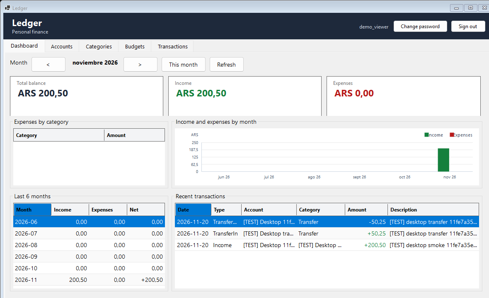
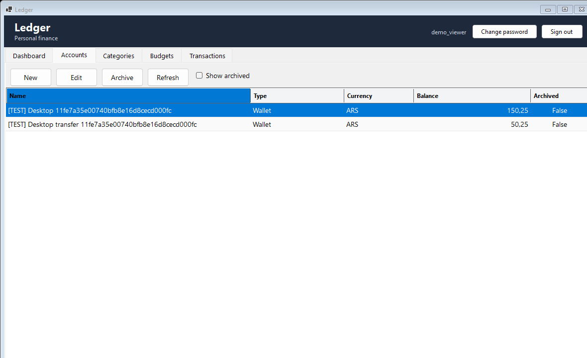
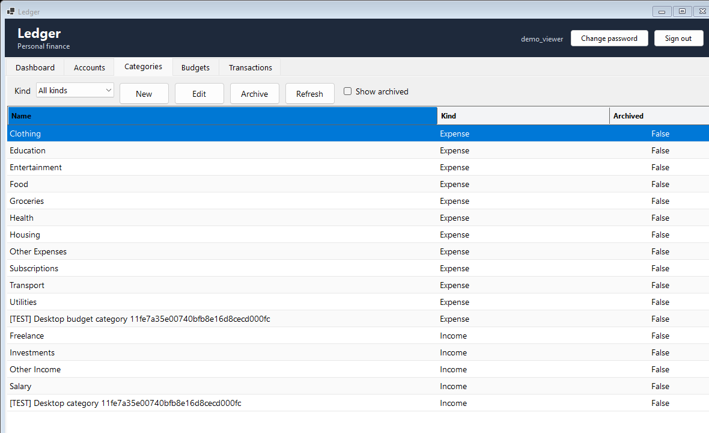
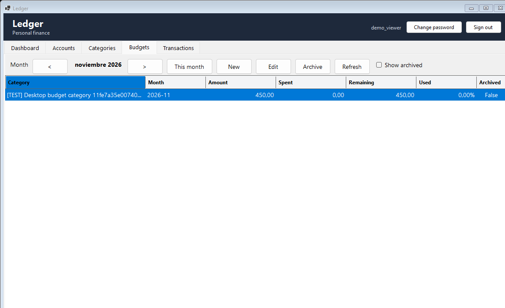
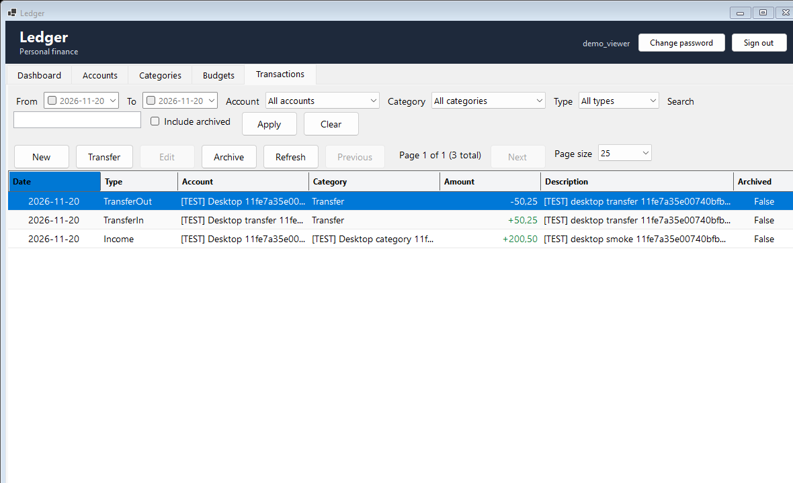

# Ledger

A personal finance management application built with C# and .NET 8.

Ledger allows users to manage their accounts, track income and expenses, organize spending categories, set monthly budgets, and monitor their financial activity through a dashboard.

## Try the demo

Download the Windows client from the [latest release](../../releases/latest) and create your own account. The executable is self-contained: no .NET installation or manual configuration is required.

**Demo invite code:** `6E847C6C91A746E5CF5CEE7B22B7A08BB77C4FA208EC3E48`

1. Download `Ledger.Desktop-1.0.0-win-x64.zip` from the release page.
2. Extract it into a local folder.
3. Run `Ledger.Desktop.exe`.
4. Select **Create account**.
5. Choose a username and a password of at least 12 characters, and enter the invite code above.

Every visitor gets a private, empty account with the default categories already created. You can add your own sample accounts, transactions and budgets without affecting anyone else.

> The first launch can take about a minute while the API wakes up. Windows SmartScreen may show a warning because the executable was downloaded from the internet. There is no password recovery, so keep your credentials. The invite code may be rotated or disabled later; accounts that already exist are not affected.

### Screenshots











## Features

- **Dashboard:** Monthly financial overview, account balances, income, expenses, spending breakdown and historical trends.
- **Accounts:** Create, edit and archive financial accounts.
- **Categories:** Organize income and expenses into custom categories.
- **Transactions:** Record, edit, search and filter transactions.
- **Transfers:** Move money between accounts with balance validation.
- **Budgets:** Set monthly spending limits and track budget usage.
- **Authentication:** JWT-based authentication with individual user accounts and data isolation.

## Architecture

Ledger follows a client-server architecture:

```text
WinForms Desktop Client
         |
      HTTP/JSON
         |
   ASP.NET Core API
         |
      EF Core
         |
     PostgreSQL
```

The desktop client communicates exclusively with the API. All business logic, validation and database access are handled by the backend.

## Tech Stack

| Component | Technology |
|---|---|
| Language | C# |
| Framework | .NET 8 |
| Desktop | Windows Forms |
| Backend | ASP.NET Core Web API |
| ORM | Entity Framework Core |
| Database | PostgreSQL |
| Authentication | JWT Bearer |
| API Documentation | Swagger / OpenAPI |
| Database Hosting | Neon |

## Project Structure

```text
Ledger/
├── src/
│   ├── Ledger.Api/
│   └── Ledger.Desktop/
├── tests/
│   ├── Ledger.Api.Tests/
│   └── Ledger.Desktop.Smoke/
├── scripts/
├── docs/
└── Ledger.sln
```

## Project Goals

Ledger was developed as a personal project to build a practical application while exploring backend development with C# and .NET.

The project focuses on:

- Designing and implementing RESTful APIs.
- Exploring AI-assisted software development workflows using OpenCode, AI agents, and different LLMs.
- Separating presentation, business logic, and data access.
- Working with relational databases and Entity Framework Core.
- Implementing authentication and authorization.
- Managing user-specific data and access control.
- Handling financial operations with data consistency in mind.
- Writing integration tests and preparing deployment workflows.

## Project Status

Ledger is a personal project developed for practical use and continuous learning. Its core functionality, authentication, and deployment infrastructure have been implemented.
